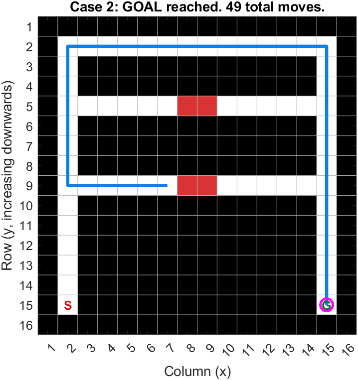
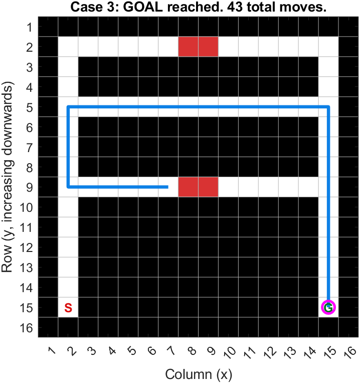
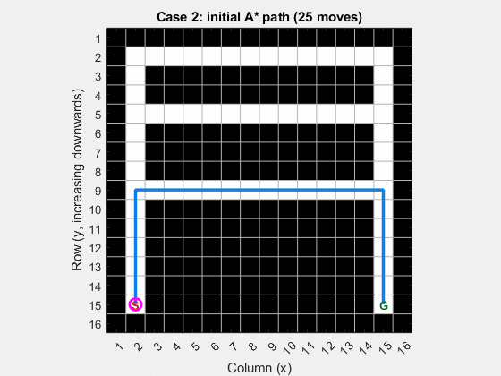

# EEP55C21 Assignment 3: A* pathfinding

## Overview

We built a MATLAB simulation of an agent moving from `S` to `G` through the prescribed 16 x 16 occupancy grid. The programme calculates and validates a route, introduces each specified obstacle after movement has begun, and replans only when the remaining route is no longer usable. This builds on the Lab 10 pathfinding work and provides the planning basis for Assignment 4, where a Crazyflie will follow physical waypoints.

## Design choices

### Pathfinding algorithm

We initially considered BFS, which was introduced in Lab 10 and is well suited to this small unweighted grid. Since every permitted move costs one, BFS guarantees a shortest path without needing a heuristic. We chose A* because Assignment 4 will extend this work to physical Crazyflie navigation. Rather than exploring in successive layers, A* prioritises cells using the travelled cost and an estimate of the remaining distance:

$$
f(n) = g(n) + h(n)
$$

This goal-directed structure is useful for larger or more complex environments and could later support varied movement costs with an appropriate heuristic. The tradeoff is additional cost tracking and priority selection. BFS remains equally capable of finding an optimal route here, so we chose A* for extensibility rather than a claimed immediate performance advantage.

### Von Neumann versus Moore

Moore initially seemed appropriate for a drone because diagonal movement could produce shorter routes. However, the maze's narrow corridors create corner-cutting concerns, especially once physical clearance and localisation error matter. We therefore retained the four-connected Von Neumann neighbourhood. Horizontal and vertical unit steps make route validation straightforward and allow Manhattan distance to remain an admissible and consistent A* heuristic. This can produce longer routes with sharper turns. Moore movement could be investigated for physical flight, but it would require diagonal costs, an octile-distance heuristic and explicit clearance checks. Von Neumann gives us a simpler, verifiable starting point without treating a valid grid route as automatically safe for the drone.

## Implementation

The grid uses `0` for free cells and `1` for obstacles. Coordinates are stored as `[row,column]`; row 1 appears at the top. A* selects the open cell with the lowest cumulative cost plus Manhattan distance and stores parent cells to reconstruct the route. Validation checks endpoints, integer grid bounds, blocked cells and unit four-connected steps.

Each obstacle case reloads the original map. The agent follows its initial route to `[9,7]`, the obstacle is introduced, and only the remaining route is checked. Invalid routes are discarded and replanned from the current cell.

## Verified results

Executed in MATLAB R2024b with the supplied A* implementation:

| Map | Initial cost | Replan | Remaining cost | Total travel | Outcome |
|---|---:|---|---:|---:|---|
| Original | 25 | No | 25 | 25 | Goal reached |
| Case 1 | 25 | Yes, from `[9,7]` | 32 | 43 | Goal reached |
| Case 2 | 25 | Yes, from `[9,7]` | 38 | 49 | Goal reached |
| Case 3 | 25 | Yes, from `[9,7]` | 32 | 43 | Goal reached |

| Case 1 | Case 2 | Case 3 |
|---|---|---|
|  |  |  |

In these final frames, grey shows the route already travelled, the orange diamond marks the replanning cell and blue shows the valid continuation.

The retention test adds Case 1 behind the agent and correctly keeps the valid route. The unreachable-goal test blocks all crossings and returns no route without attempting movement.

## Limitations and Assignment 4

This simulation assumes a known discrete map and ideal cell-to-cell movement. It does not represent drone dimensions, localisation error, trajectory curvature or sensor uncertainty. For Assignment 4 we will port the planner to Python, map cells to physical waypoints, use Loco Positioning feedback and check real clearance before flight. The required Assignment 4 obstacle configurations are selected before take-off; autonomous mid-flight obstacle detection is not required.

## Running the code

Open `Assignment3_AStar.m` in MATLAB R2024b and select **Run** to reproduce the original map, all three independent obstacle cases and both extra tests. No additional toolboxes or files are required. Parts 6 and 7 can also be run independently. Set `CPS_NO_ANIMATION=1` for headless verification.
