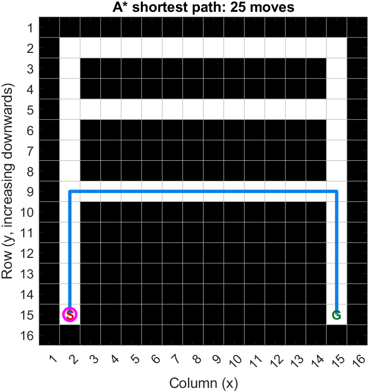
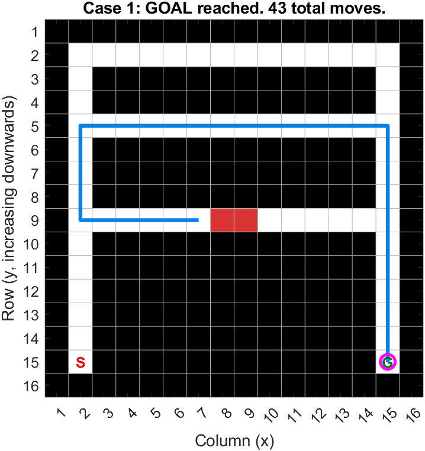

# EEP55C21 Assignment 3: A* pathfinding

## Overview

We built a MATLAB simulation of an agent moving from `S` to `G` through the prescribed 16 x 16 occupancy grid. The programme calculates and validates a route, introduces each specified obstacle after movement has begun, and replans only when the remaining route is no longer usable. This builds on the Lab 10 pathfinding work and provides the planning basis for Assignment 4, where a Crazyflie will follow physical waypoints.

## Design choices

We first considered breadth-first search because Lab 10 supplied a working version and every allowed move costs one. BFS would be fully sufficient here and guarantees a shortest path on this unweighted grid. We chose A* to combine the travelled cost `g(n)` with an estimate of the remaining cost `h(n)`, giving `f(n) = g(n) + h(n)`. Our heuristic is Manhattan distance because movement is limited to horizontal and vertical unit steps. It is admissible and consistent for this model.

A* adds open-set, score and tie-breaking logic that BFS does not need. We accepted that extra complexity because the structure is useful for later problems with larger environments or varied movement costs. We did not benchmark A* against BFS on this map, so we make no speed claim for this assignment.

We retained the four-connected Von Neumann neighbourhood. The maze has narrow corridors and sharp corners, and axial movement makes route validity unambiguous without diagonal corner-cutting. Moore movement could create shorter geometric routes and better reflect a drone's diagonal freedom, but it would need diagonal costs, a matching heuristic and explicit corner rules. A legal diagonal grid step also says nothing about physical Crazyflie clearance. Four-connected paths can be less direct and contain more turns, but this is a deliberate Assignment 3 simplification rather than a universal safety rule.

## Implementation

The grid uses `0` for free cells and `1` for obstacles. Coordinates are stored as `[row,column]`; row 1 appears at the top. A* selects the open cell with the lowest cumulative cost plus Manhattan distance and stores parent cells to reconstruct the route. Validation checks endpoints, integer grid bounds, blocked cells and unit four-connected steps.

Each obstacle case reloads the original map. The agent follows its initial route to `[9,7]`, the obstacle is introduced, and only the remaining route is checked. Invalid routes are discarded and replanned from the current cell. The programme also reports an empty result cleanly when no route exists.

## Verified results

Executed in MATLAB R2024b with the supplied A* implementation:

| Map | Initial cost | Replan | Remaining cost | Total travel | Outcome |
|---|---:|---|---:|---:|---|
| Original | 25 | No | 25 | 25 | Goal reached |
| Case 1 | 25 | Yes, from `[9,7]` | 32 | 43 | Goal reached |
| Case 2 | 25 | Yes, from `[9,7]` | 38 | 49 | Goal reached |
| Case 3 | 25 | Yes, from `[9,7]` | 32 | 43 | Goal reached |

| Case 1 | Case 2 | Case 3 |
|---|---|---|
|  |  |  |

The extra retention test introduces Case 1 after the agent has passed the blocked cells and correctly keeps the valid route. The unreachable-goal test blocks all crossings and returns no route without attempting movement.

## Limitations and Assignment 4

This simulation assumes a known discrete map and ideal cell-to-cell movement. It does not represent drone dimensions, localisation error, trajectory curvature or sensor uncertainty. For Assignment 4 we will port the planner to Python, map cells to physical waypoints, use Loco Positioning feedback and check real clearance before flight. The required Assignment 4 obstacle configurations are selected before take-off; autonomous mid-flight obstacle detection is not required.

## Running the code

Open `Assignment3_AStar.m` in MATLAB R2024b and select **Run** to reproduce the original map, all three independent obstacle cases and both extra tests. No additional toolboxes or files are required. Parts 7 and 8 can also be run as sections after their stated prerequisites. Set `CPS_NO_ANIMATION=1` for headless verification and `CPS_EXPORT_ASSETS=1` to regenerate the figures in `assets/`.
